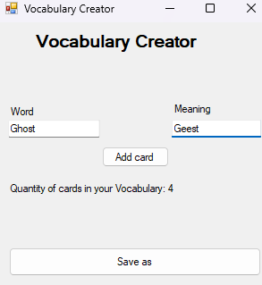

# Vocabulary Creator

A simple Windows Forms application built with C# for creating vocabulary lists and exporting them to JSON files.

## Features

- Add vocabulary entries using key-value pairs.
- Validate input fields.
- Store vocabulary in a Dictionary.
- Save files for a future use in [my another application](https://github.com/necr0smvncer-commits/Vocabulary_Trainer)

## Technologies

- C#
- Windows Forms

## Screenshot

## Example JSON

See `VocabularyExample/example.json`.

## Download

Download the latest version from [Releases](../../releases).
